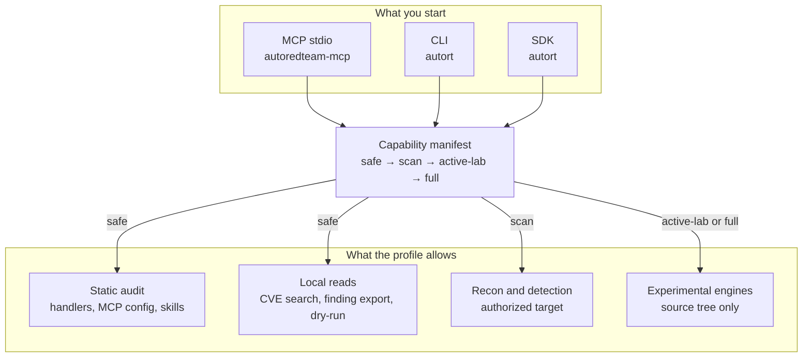

# AutoRedTeam-Orchestrator

A local audit and evidence gate for MCP servers and AI-agent tools. You point it at your own handlers, client config, or skill files. It reads them, writes findings with file and line, and refuses anything the selected profile did not declare.

The model can judge. This process keeps the profile, the evidence, and the record.


[Capability maturity](docs/capability-maturity.md) · [Security model](docs/security-model.md) · [Security audits](docs/security-audits/)

Beta / research preview. Static analysis, dry-runs, and local labs are the supported path. Exploit, lateral movement, persistence, C2, and exfiltration stay in the source tree as restricted experiments. A policy flag or a sandbox label is not an operating-system or container boundary.

## Start here

From a checkout, `typer` is enough for the read-only commands. They do not contact a target and they do not import the experimental engines.

```bash
pip install typer
python -m cli.main ai-surface scan --path handlers --format sarif -o surface.sarif
python -m cli.main ai-surface scan-mcp-config --path .mcp.json
python -m cli.main capabilities manifest --profile safe
```

`ai-surface scan` skips tests unless you ask for them. A scan of the repository root or of `handlers/` also reconciles what it saw with the capability manifest. The JSON summary field is `summary.static_coverage`. The SARIF copy lives at `runs[].properties.static_coverage`.

Install the two commands if you want them on `PATH`:

```bash
pip install autoredteam-orchestrator
pipx install autoredteam-orchestrator
uvx --from autoredteam-orchestrator autort --help
```

Or from Git, when PyPI is behind the branch you care about:

```bash
pip install "git+https://github.com/Coff0xc/AutoRedTeam-Orchestrator.git"
git clone https://github.com/Coff0xc/AutoRedTeam-Orchestrator.git
cd AutoRedTeam-Orchestrator
pip install -r requirements.txt
python -m cli.main --help
```

Python 3.10 or newer. Version `3.1.0` comes from `_version.py` only. The console scripts are `autort` and `autoredteam-mcp`.

## How the pieces sit

Three thin entries share one manifest. MCP stdio, the Typer CLI, and the async SDK all ask the same gate which surfaces exist for the selected profile. `core/` is where the work lives. A surface that the manifest does not name fails registration with `CapabilityManifestError`.



The profile is chosen in this order: an explicit argument, then `AUTORT_CAPABILITY_PROFILE`, then `safe`. A tool whose `minimum_profile` is above the selection is not registered. The same check runs before the CLI or SDK imports the matching engine.

Direct `import` of `core` from your own script does not pass through that gate.

## Profiles

Each profile includes the one before it.

| Profile | What it opens | Where it belongs |
|---|---|---|
| `safe` | Static audit, dry-run scenarios, local CVE search, finding export, local session reads | The default. A trusted local process. |
| `scan` | Recon and vulnerability detection, report generation | An authorized target, with the network path you already control. |
| `active-lab` | Exploit validation surfaces | A disposable lab, a separate approval, an isolated executor, and an API key. |
| `full` | Post-exploitation and the rest of the catalog | Explicit opt-in. Isolated, authorized, disposable. |

```bash
autort capabilities profiles
autort capabilities manifest --profile safe
```

Authorization is a second switch, not a synonym for the profile. `AUTOREDTEAM_AUTH_MODE` defaults to `strict`. Protected tools then require `AUTOREDTEAM_API_KEY` (`MCP_API_KEY` is accepted as an alias). `permissive` logs and allows. `disabled` is honored only when `AUTOREDTEAM_ENV=test` or `PYTEST_CURRENT_TEST` is set.

The manifest entry for each surface records kind, name, handler, category, minimum profile, risk, maturity, and declared controls: whether auth is required, whether approval is required, and which executor is expected (`in-process`, `external-process`, or `isolated-required`). Those control fields decide what the MCP schema shows. They do not, by themselves, authenticate a caller or isolate a process.

## What the audit actually reads

`ai-surface` is a static reader. It parses Python with `ast`. It does not import handler modules, register tools, call targets, or open a network connection.

`scan` walks handler files and records three shapes:

- FastMCP decorators `@tool`, `@prompt`, and `@resource`, including `description=` on the decorator
- low-level SDK `Tool(...)` declarations
- `DetectorConfig(name=...)` factory tools, which have no inline function body

Test modules, `tests/`, and `conftest.py` are skipped by default. The walk also skips VCS directories, virtualenvs, `node_modules`, build output, and `wordlists`.

`scan-mcp-config` accepts a file or a directory. In a directory it looks for `.mcp.json`, `mcp.json`, and `claude_desktop_config.json`. These objects are the same inventory: `mcpServers`, a top-level `servers` map, and `mcp.servers`. A general command runtime and a secret-like environment **name** become findings. Matching is on identifier boundaries, so a name like `monkey` is not treated as a key. A declared `url`, `serverUrl`, or `baseUrl` is recorded as a remote endpoint. The finding text does not copy that URL. The line number is the line of the server key. The scan never connects.

`scan-skills` reads local markdown, text, YAML, JSON, and TOML. Lockfiles such as `package-lock.json` and `poetry.lock` are left out. A file larger than 1 MiB is skipped and named in the warnings when the path is a directory. Point the command at a single file if you really want that file read.

`diff` takes a JSON file written by an earlier `ai-surface scan` and compares it with a fresh handler scan. It reports surfaces that were added, removed, or whose description or parameter names changed. It still does not connect or call a tool.

For an external repository that does not use this project's auth decorators, pass `--auth-mode lenient`. That drops missing-auth issues. It does not change the parse.

CI flags on `ai-surface`: `--ci` prints a short summary, and `--exit-code` returns non-zero when a finding reaches `--severity-threshold` (`info`, `low`, `medium`, `high`, `critical`).

## GitHub Action

The example below is the pin this repository documents. It sets `mode` on purpose. Current `main` defaults the Action to `self-audit`. The `v3.1` tag still defaults to `target-scan`, and that mode requires a `target` input.

```yaml
- uses: Coff0xc/AutoRedTeam-Orchestrator@v3.1
  with:
    mode: self-audit
    path: '.'
    severity-threshold: high
```

The full workflow is [`.github/workflows/self-audit.example.yml`](.github/workflows/self-audit.example.yml). Output defaults to SARIF and is uploaded for code scanning. `path` is relative to the caller repository unless it is absolute.

`mode: target-scan` remains available for an authorized URL. It runs detection, and it needs `target`.

## MCP client

The server speaks stdio. There is no cloud service and no telemetry.

```bash
autoredteam-mcp --stdio
python -m mcp_stdio_server --stdio
```

A client config can use any of the shapes the scanner understands. This is the usual `mcpServers` form:

```json
{
  "mcpServers": {
    "autoredteam": {
      "command": "autoredteam-mcp",
      "args": ["--stdio"],
      "env": {
        "AUTORT_CAPABILITY_PROFILE": "safe",
        "AUTOREDTEAM_AUTH_MODE": "strict",
        "AUTOREDTEAM_API_KEY": "replace-with-a-real-key"
      }
    }
  }
}
```

Leave the profile unset and the server stays on `safe`.

The published container is a multi-stage `python:3.12-slim` image. It installs the wheel, sets `AUTORT_CAPABILITY_PROFILE=safe`, runs as `appuser`, and starts `autoredteam-mcp`. The experimental engine packages are excluded from that wheel, the same way `pyproject.toml` excludes them from the default install.

## CLI

Installed, the command is `autort`. From a checkout, `python -m cli.main` is the same program.

### Safe

These do not contact a target. `cve-search` reads local CVE intelligence.

| Command | What you get | Example |
|---|---|---|
| `ai-surface scan` | Handler inventory, SARIF or JSON | `autort ai-surface scan --path handlers --format sarif -o surface.sarif` |
| `ai-surface scan-mcp-config` | Client config inventory | `autort ai-surface scan-mcp-config --path .mcp.json` |
| `ai-surface scan-skills` | Instruction markers in skill files | `autort ai-surface scan-skills --path ./skills` |
| `ai-surface diff` | Saved scan JSON against the current handlers | `autort ai-surface diff --baseline surface.json --path handlers` |
| `capabilities profiles` | Inheritance and surface counts | `autort capabilities profiles` |
| `capabilities manifest` | One profile, as data | `autort capabilities manifest --profile safe` |
| `tools lint` | Static MCP tool-contract check | `autort tools lint --path handlers` |
| `cve-search` | Local CVE search | `autort cve-search "Log4j" --severity critical --has-poc -n 20` |
| `version` | The version string | `autort version` |

### Other safe groups

| Group | Commands | What it is |
|---|---|---|
| `ai-surface` | `scan`, `scan-mcp-config`, `scan-skills` | The audit above |
| `capabilities` | `matrix`, `readiness`, `manifest`, `profiles` | Manifest and coverage |
| `tools` | `lint` | Contract check |
| `code-agent` | `expand` | Call-chain context. It does not run the code. |
| `runtime-api` | `serve` | Read-only local view of run state at `/api/runs` |
| `sandbox` | `docker-smoke` | Local Docker smoke test |
| `ai-redteam` | `run`, `catalog`, `convert`, `eval-run` | Declarative scenarios. Dry-run unless you opt further in. |

`autort tools` is that `lint` group. External-tool status is the manifest surface `ext_tools_status`, minimum profile `scan`, and it has no separate CLI command today.

### Higher profiles

`safe` refuses these. Examples assume an authorized target.

| Command | Minimum profile | Example |
|---|---|---|
| `scan` | `scan` | `autort scan http://127.0.0.1:8000 --full` |
| `detect` | `scan` | `autort detect http://127.0.0.1:8000 -c sqli,xss,ssrf --format sarif` |
| `nuclei` | `scan` | `autort nuclei http://127.0.0.1:8000 -t cve,rce -s high,critical` |
| `report` | `scan` | `autort report <session-id> -f html` |
| `exploit` | `active-lab` | `autort exploit http://127.0.0.1:8000 --cve CVE-2021-44228` |
| `pentest` | `full` | `autort pentest http://127.0.0.1:8000 --phases recon,vuln_scan` |

## SDK

Import it from a checkout. Calls are async. Most return a `dict`. A few scan methods return a list. Success is `"success": True`. A failure carries an `"error"` string. If the profile is too low, the call stops before the engine import.

On `safe`, start with local search and finding export:

```python
from autort import Exploiter, Reporter
from autort import __version__  # "3.1.0"

exploiter = Exploiter("http://127.0.0.1:8000")
cves = await exploiter.cve_search("Apache Log4j", severity="critical", has_poc=True)

reporter = Reporter("session_id_here")
findings = await reporter.export_findings(format="json")
```

`AutoPentest.status(session_id)` reads local session state. That maps to `session_status` and stays on `safe`.

`Scanner` needs `scan`. The methods are `full_recon()`, `port_scan()`, `detect_vulns()`, `fingerprint()`, `waf_detect()`, `subdomain_enum()`, `passive_recon()`, and `nuclei_scan()`. Set `AUTORT_CAPABILITY_PROFILE=scan` or pass a higher profile before calling them.

`Reporter.generate()` maps to `generate_report` and also needs `scan`. `Exploiter.cve_exploit()`, `auto_exploit()`, and `exploit()` need `active-lab` or above. `AutoPentest.run()` and `resume()` need `full`. `RedTeam` collects lateral movement, C2, persistence, privilege escalation, and credential discovery. Those are `full` surfaces. This page lists them as a catalog and does not show call examples.

## What is in the default install

The wheel and the container include the audit, the manifest, the CLI, the SDK, and the handlers. They omit the experimental engine packages: C2, lateral movement, persistence, post-exploitation, privilege escalation, exfiltration, evasion, credentials, Active Directory, and exploit. A source checkout can still import those packages when the profile allows it.

Recon and detection ship, and they stay behind `scan`. There is no public accuracy benchmark for the detectors, so their thresholds are not a claim this document makes.

| Area | Status | Boundary |
|---|---|---|
| Static AI/MCP audit | Preview | Read-only AST to SARIF. Default `safe`. |
| CVE intelligence | Preview | Local search on `safe`. Sync and PoC execution need a higher profile. |
| Reports | Beta for JSON and SARIF export. HTML is still hardening. | `export_findings` is `safe`. `generate_report` is `scan`. |
| Recon and detection | Beta | `scan`, authorized targets. |
| Orchestration and post-exploitation | Restricted experimental | `active-lab` or `full`, disposable labs. |

The longer matrix is [Capability maturity](docs/capability-maturity.md). Trust boundaries are in the [Security model](docs/security-model.md).

## License

MIT. See [`LICENSE`](LICENSE).

Use it for authorized testing, internal review, education, and local labs. Get permission from the owner of any target. Unauthorized scanning, exploitation, persistence, exfiltration, or evasion is out of scope for this project.
