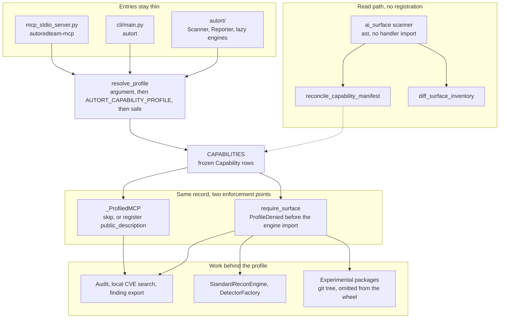

# AutoRedTeam-Orchestrator

A local audit and evidence gate for MCP servers and AI-agent tools. You point it at your own handlers, client config, or skill files. It reads them, writes findings with file and line, and refuses anything the selected profile did not declare.

The model can judge. This process keeps the profile, the evidence, and the record.


[Capability maturity](docs/capability-maturity.md) · [Security model](docs/security-model.md) · [Security audits](docs/security-audits/)

Beta / research preview. Static analysis, dry-runs, and local labs are the supported path. Exploit, lateral movement, persistence, C2, and exfiltration stay in the source tree as restricted experiments. A policy flag or a sandbox label is not an operating-system or container boundary.

The numbers below come from `core/capability_manifest.py` in this tree: **142 surfaces** (132 tools, 6 prompts, 4 resources). A later registration change shows up in `autort capabilities profiles` before this page does.

## Contents

- [Start here](#start-here)
- [Why the repository is shaped this way](#why-the-repository-is-shaped-this-way)
- [How a call moves](#how-a-call-moves)
- [The capability record](#the-capability-record)
- [How a surface reaches the MCP server](#how-a-surface-reaches-the-mcp-server)
- [Why the audit parses source](#why-the-audit-parses-source)
- [Client configs and skill files](#client-configs-and-skill-files)
- [Inventory diff](#inventory-diff)
- [Tool-contract lint](#tool-contract-lint)
- [Evidence gate](#evidence-gate)
- [Session, configuration, and reports](#session-configuration-and-reports)
- [Recon and detection](#recon-and-detection)
- [Orchestration and the experimental tree](#orchestration-and-the-experimental-tree)
- [Agent runtime, scenarios, and code context](#agent-runtime-scenarios-and-code-context)
- [CLI and SDK](#cli-and-sdk)
- [GitHub Action](#github-action)
- [Container](#container)
- [What this tree leaves undone](#what-this-tree-leaves-undone)
- [License](#license)

## Start here

From a checkout, `typer` is enough for the read-only commands. They do not contact a target and they do not import the experimental engines.

```bash
pip install typer
python -m cli.main ai-surface scan --path handlers --format sarif -o surface.sarif
python -m cli.main ai-surface scan-mcp-config --path .mcp.json
python -m cli.main capabilities manifest --profile safe
```

`ai-surface scan` skips tests unless you ask for them. A scan of the repository root or of `handlers/` also reconciles what it saw with the capability manifest. The JSON summary field is `summary.static_coverage`. The SARIF copy lives at `runs[].properties.static_coverage`.

Install the two commands if you want them on `PATH`:

```bash
pip install autoredteam-orchestrator
pipx install autoredteam-orchestrator
uvx --from autoredteam-orchestrator autort --help
```

Or from Git, when PyPI is behind the branch you care about:

```bash
pip install "git+https://github.com/Coff0xc/AutoRedTeam-Orchestrator.git"
git clone https://github.com/Coff0xc/AutoRedTeam-Orchestrator.git
cd AutoRedTeam-Orchestrator
pip install -r requirements.txt
python -m cli.main --help
```

Python 3.10 or newer. Version `3.1.0` comes from `_version.py` only. The console scripts are `autort` (`cli.main:app`) and `autoredteam-mcp` (`mcp_stdio_server:main`).

## Why the repository is shaped this way

The default product is a local reviewer of MCP and agent surfaces, plus a record of what was allowed to run. A large tool menu is still in the tree because those modules already exist and some labs still call them. The published install and the default profile do not expose them.

Four decisions follow from that.

**One record decides exposure.** `Capability` in `core/capability_manifest.py` is the registration source of truth. MCP, the CLI, and the SDK ask that record. A surface the record does not name raises `CapabilityManifestError` and registration stops. Duplicate `(kind, name)` pairs fail at import, when `_CAPABILITY_INDEX` is built.

**The model sees the record, not the handler docstring.** `public_description()` is the text FastMCP stores. It states the name, kind, minimum profile, risk, declared effects, and controls, then tells the caller to use only the declared parameters. Handler prose used to be what the model read. That prose could describe a procedure the profile was supposed to withhold, so registration overwrites both `description=` and `func.__doc__`.

**Parsing stays on the far side of import.** `core/ai_surface` uses `ast`. Importing `handlers` would execute registration and pull engines. The audit has to be able to read a checkout, including one that still contains experimental packages, without starting those packages.

**The wheel is smaller than the git tree.** `pyproject.toml` excludes C2, lateral movement, persistence, post-exploitation, privilege escalation, exfiltration, evasion, credentials, Active Directory, and exploit. Those packages remain for an explicit `full` checkout. Deleting them would break that checkout. A second repository would split the manifest from the code it describes. Exclusion plus lazy import is the boundary that keeps one tree and two audiences.

Direct `import` of `core` from your own script does not pass through the gate. The gate is the three entries. It is also not authentication, target scope, approval, or process isolation. Those are separate fields on the same record, and they stay declarative until a decorator or an executor actually enforces them.

## How a call moves



Profile order is cumulative: `safe`, then `scan`, then `active-lab`, then `full`. `resolve_profile` takes an explicit argument, then `AUTORT_CAPABILITY_PROFILE`, then `safe`. Names are stripped, lower-cased, and `_` is rewritten to `-`, so `active_lab` and `active-lab` are the same value. Anything else raises `CapabilityManifestError`.

`allowed_in` is index arithmetic on `PROFILE_ORDER`. A surface whose `minimum_profile` is `scan` is present in `scan`, `active-lab`, and `full`. It is absent from `safe`.

| Profile | Minimum-profile rows | Surfaces visible, including earlier profiles | Operating boundary stored on the profile |
|---|---:|---:|---|
| `safe` | 23 | 23 | Trusted local process. |
| `scan` | 63 | 86 | An authorized target and the network path you already control. |
| `active-lab` | 20 | 106 | A disposable lab, a separate approval, an isolated executor. |
| `full` | 36 | 142 | Explicit opt-in. Isolated, authorized, disposable. |

Authorization is a second switch. `AUTOREDTEAM_AUTH_MODE` defaults to `strict`. Protected tools then require `AUTOREDTEAM_API_KEY` (`MCP_API_KEY` is accepted as an alias). `permissive` logs and allows. `disabled` is honored only when `AUTOREDTEAM_ENV=test` or `PYTEST_CURRENT_TEST` is set, which is how the test session runs without a key. A profile of `full` does not turn auth off.

## The capability record

`Capability` is a frozen dataclass. One row is one public surface.

| Field | What it is for |
|---|---|
| `kind` | `tool`, `prompt`, or `resource`. The index key is `(kind, name)`. |
| `name` | The public MCP name. It must match the decorator `name=` or the function name. |
| `handler` | Which registration module owns it. `_ProfiledMCP` refuses a mismatch. |
| `category` | Counter bucket in the startup log (`recon`, `detector`, `cve`, …). |
| `minimum_profile` | Lowest profile that may register or call it. |
| `risk` | `low`, `moderate`, `high`, or `critical`. This is policy metadata. |
| `maturity` | `preview`, `beta`, `experimental`, `restricted-experimental`, or `internal`. |
| `auth_required` | Whether the MCP schema should demand an auth gate. |
| `approval_required` | Whether an independent approval is part of the declared control set. |
| `executor` | `in-process` (80), `isolated-required` (56), or `external-process` (6). |
| `effects` | Declared effect labels, joined into the model-facing sentence. |
| `locator` | Resource URI, when the surface is a resource. |

Current risk mix: moderate 59, critical 46, high 19, low 18. Current maturity mix: restricted-experimental 46, preview 41, beta 38, experimental 11, internal 6. Maturity is a label for readers of the manifest. It does not change registration.

`public_description()` always has the same shape:

```text
{name} is a {kind} in the {minimum_profile} profile. Risk: {risk}. Effects: {effects}. Controls: {controls}. Use only the declared parameters. This description does not authorize a target or an action.
```

Controls start with `profile-registration`, then `authentication` and `independent-approval` when those flags are set, then the executor name. Empty effects render as `none`.

Prompt *functions* return `render_prompt_body`. That body repeats the description, lists `Declared parameters:`, and ends with one sentence: the prompt returns the constraint and the parameters. The Python function names stay the manifest names (`plan_pentest`, `plan_attack_chain`, `suggest_next_phase`, and the safe prompts `analyze_findings`, `write_report`, `explain_vulnerability`). The names are stable identifiers. The returned text is the constraint. `plan_pentest` is `active-lab`, high risk, experimental, and requires auth plus approval. It is registered as a prompt surface. It is not a procedure generator.

`require_surface(name)` resolves the profile, loads the row, and raises `ProfileDenied` when `allowed_in` is false. The CLI turns that into `typer.Exit(2)` after echoing the message. SDK methods call `require_surface` before they import the mapped engine, and before the broad `except Exception` that turns engine failures into `{"success": False, "error": ...}`. A denied profile is therefore a distinct failure, not a swallowed engine error.

`handler_enabled(profile, handler)` is true when that handler owns at least one surface allowed in the profile. An unknown handler name is `CapabilityManifestError`. This is what lets `safe` skip whole modules.

`capability_manifest(profile)` and `capability_profiles()` are the JSON behind `autort capabilities manifest` and `autort capabilities profiles`. `reconcile_capability_manifest` materializes the capability sequence once. A one-shot iterator is not consumed by a count and then found empty.

## How a surface reaches the MCP server

`mcp_stdio_server.py` builds `FastMCP("AutoRedTeam")`, resolves the profile, and calls `handlers.register_all_handlers`. Startup then logs the legal disclaimer and the auth mode. `--stdio` selects the stdio transport. There is no cloud service and no telemetry.

`handlers/__init__.py` does not import the twenty-two handler modules at package import. `_REGISTER_LOADERS` maps each `register_*` name to a module, and module `__getattr__` imports that module on first use. `from handlers import register_recon_tools` therefore loads recon. `import handlers` does not load lateral, persistence, or the rest.

Registration order is fixed, because a later module must not depend on an earlier one having run, and because the startup log should be stable:

| Order | Module | Manifest `handler` | Surfaces in this tree |
|---:|---|---|---:|
| 1 | `recon_handlers` | `recon` | 9 |
| 2 | `detector_factory` | `detector` | 28 |
| 3 | `evidence_handlers` | `evidence` | 1 |
| 4 | `cve_handlers` | `cve` | 8 |
| 5 | `api_security_handlers` | `api_security` | 7 |
| 6 | `cloud_security_handlers` | `cloud_security` | 3 |
| 7 | `supply_chain_handlers` | `supply_chain` | 3 |
| 8 | `redteam_handlers` | `redteam` | 14 |
| 9 | `orchestration_handlers` | `orchestration` | 11 |
| 10 | `lateral_handlers` | `lateral` | 9 |
| 11 | `persistence_handlers` | `persistence` | 3 |
| 12 | `ad_handlers` | `ad` | 3 |
| 13 | `session_handlers` | `session` | 4 |
| 14 | `report_handlers` | `report` | 2 |
| 15 | `ai_handlers` | `ai` | 11 |
| 16 | `misc_handlers` | `misc` | 3 |
| 17 | `external_tools_handlers` | `external_tools` | 8 |
| 18 | `parallel_handlers` | `parallel` | 1 |
| 19 | `knowledge_handlers` | `knowledge` | 3 |
| 20 | `mcts_handlers` | `mcts` | 1 |
| 21 | `prompt_handlers` | `prompts` | 6 |
| 22 | `resource_handlers` | `resources` | 4 |

The module docstring at the top of `handlers/__init__.py` is an older catalog (it still says 8 recon tools and 26 detector tools). The table above is the live manifest. When the two disagree, the manifest wins, and registration will refuse a name the manifest does not list.

For each row, `register_all_handlers` does four things.

1. If `handler_enabled` is false, the module is not imported. Under `safe`, lateral, persistence, AD, red team, and the other higher-only modules stay unloaded. That is the import boundary, distinct from the wheel boundary.
2. The module's `register_*` function receives a `_ProfiledMCP`, not the raw FastMCP instance.
3. `_ProfiledMCP.tool` / `.prompt` / `.resource` look up `(kind, public_name)`. `public_name` is the decorator `name=` when set, otherwise `func.__name__`. The row's `handler` must equal the module currently registering. A copy-pasted tool in the wrong file fails closed.
4. When `allowed_in` is false, the decorator returns the original function and does not call FastMCP. A mixed module can contain one `safe` tool and one `full` tool. The `full` function stays a plain function. When `allowed_in` is true, the wrapper writes `public_description()` onto the function and into the decorator `description=`, then registers, then increments the counter by one.

The counter the modules see is a `_CounterView`. Its `add` ignores the historical "I registered N tools" batch calls. Only `_ProfiledMCP` increments, so a filtered profile cannot report the old full-catalog total. When the profile is not `full`, a `_ProfileLoggerView` drops log lines that contain `已注册` or `注册完成`, which were the old per-module success lines.

Registration is once per FastMCP instance. The wrapper sets `_autort_capability_profile` on the instance. A second call raises `CapabilityManifestError` and tells you to construct a new instance. That prevents a `safe` server from later gaining `full` tools on the same object.

`ImportError`, `AttributeError`, and `TypeError` from one module are logged and the loop continues. A missing optional dependency in one experimental module does not blank the audit tools. `CapabilityManifestError` is re-raised. An unclassified or mis-filed surface is a packaging bug, and the server should not start half-described. Any other exception is also logged and skipped, so a broken third-party import in one module leaves the others registered.

`_ProfiledMCP` is why tests can assert that every listed description equals `public_description()` for all four profiles. MCP 2.3 stores the `description=` argument and returns it from `list_*`. The docstring overwrite keeps older callers that still read `__doc__` on the same text.

## Why the audit parses source

`scan_handler_surface` walks Python files, `ast.parse`s each one, and never imports the module. A syntax error, an unreadable file, or a decode error becomes a warning and the walk continues. Findings sort by risk, then path, then line.

The visitor records three declaration shapes, because this repository and the clients it audits do not share one style.

| Shape | AST the visitor looks for | Why it exists |
|---|---|---|
| Decorator | `@tool`, `@prompt`, `@resource` on a function or async function | FastMCP handlers in this repo. |
| Low-level constructor | `Tool(...)` or `*.Tool(...)` | The MCP SDK type `mcp.types.Tool`, used where there is no wrapper decorator. |
| Factory | `DetectorConfig(name=...)` | Detector tools are generated from configuration. There is no function body to walk, so the config call is the surface. |

Decorator `name=` and `description=` are often not string literals. Low-level tools in particular use `Tool(name=self.name)`. `_collect_string_bindings` records module-level `X = "..."` and `self.X = "..."` assignments of string constants, first assignment wins. `_resolve_str` then resolves a constant, a name, an attribute, or the constant parts of an f-string. A dynamic name that is only built at runtime stays invisible to the scanner. That is accepted: the scanner reports what the source says, and reconcile reports what the manifest still cannot see.

Risk is a haystack, not the first line of the docstring. The haystack includes the function name, the full decorator `description=`, the docstring's first line, and called names. The displayed description is the decorator description's first line when that keyword exists, otherwise the docstring's first line. A keyword in `description=` cannot hide from the haystack by staying out of the docstring, and a long description does not flood the finding text.

Called names pass through `_risk_relevant_called_names`. `SAFE_RUNTIME_HELPER_CALLS` (`blocked_handler_runtime_response`, `complete_handler_runtime_action`, `complete_handler_runtime_payload`, `gate_handler_runtime_action`, `sanitize_runtime_inputs`) are removed first. Those helpers are the gate itself. Matching them would mark a gated tool as risky because it called the gate.

`_contains_term` matches on identifier boundaries. `_` and `-` are boundaries, and the haystack already rewrites `-` to `_`. `scan` matches `port_scan` and `scan-host`. It does not match `scanner` or `epoch`. The term lists live next to the scanner: critical terms include `c2`, `credential`, `lateral`, `persistence`; high terms include `exploit`, `payload`, `poc`, `shell`; moderate terms include `scan`, `recon`, `detect`. Auth decorators `require_moderate_auth`, `require_dangerous_auth`, and `require_critical_auth` set a floor. Target-shaped parameters (`url`, `host`, `target`, `domain`, and the rest of `TARGET_PARAMS`) raise the floor to moderate unless the annotation contains `dict`. An INFO finding that still has a description is stored as LOW, so a described tool is visible in a risk-sorted report.

A second helper, `_downgrade_read_only_risk`, is deliberately narrower and older. It runs only for HIGH-or-above findings that have no target parameter, whose matched terms are only `poc`, and whose tool name contains `list`, `search`, `stats`, `status`, or `query` as a substring, while not containing `execute`, `exploit`, `generate`, `spray`, or `start`. That substring check is not `_contains_term`. A name such as `poc_listener` contains `list`, so this helper lowers it. The labeled fixture `tests/fixtures/ai_surface/labels.json` pins that result. Replacing the substring check with identifier boundaries changes the default `handlers/` scan and is a separate, measured change.

Issues the visitor can attach:

| Issue | When |
|---|---|
| `high_risk_tool_without_dangerous_auth` | Risk is HIGH or above and the auth decorator is below dangerous. |
| `critical_tool_without_critical_auth` | Risk is CRITICAL and the auth decorator is not critical. |
| `target_input_without_handler_validator` | A target-shaped parameter has no `validate_inputs` decorator. |
| `payload_generation_without_auth_gate` | The haystack matched `payload` and there is no auth decorator. |

Prompts and resources skip that issue list. Their authorization lives on the manifest row, not on `@tool` auth decorators.

SARIF rule ids are grouped by class (`mcp_tool.auth-critical`, `mcp_tool.auth-missing`, `mcp_tool.target-input`, `mcp_tool.factory`, `mcp_tool.lowlevel`, `mcp_prompt`, `mcp_resource`, `mcp_config`, `skill_instruction`, `surface_inventory_diff`). Code Scanning can aggregate. One rule per tool name would make the alert list a catalog.

### Reconcile

The scanner sees source patterns. The manifest sees what registration will accept. `reconcile_capability_manifest` joins them on `(kind, name)` and stores the report on the scan result.

| Bucket | Meaning |
|---|---|
| `statically_observed` | A finding name matches a manifest row and the finding is not a factory config. |
| `factory_accounted` | The match came from `DetectorConfig`. The tool has no inline body, so this is how the detector catalog stays visible. |
| `invisible` | A manifest row had no matching finding. Reasons are `factory-generated` (detector handler, no config call seen), `prompt`, `resource`, or `unseen`. |
| `unlisted` | A finding name is not in the manifest. Registration would reject that name. |

Reconcile runs when you scan the repository root or a directory named `handlers`, unless you pass `reconcile=False`. A single file or a foreign directory stays a pure parse. Default `exclude_tests=True` skips `tests/`, `test_*.py`, `*_test.py`, and `conftest.py`, so the labeled fixtures are not production surfaces. The fixture tests opt back in.

The walk also skips `.git`, `.hg`, `.svn`, `.venv`, `venv`, `node_modules`, `__pycache__`, `.mypy_cache`, `.pytest_cache`, `.tox`, `build`, `dist`, `wordlists`, and symlinks. Wordlists and dependency trees are large and they are not handler source.

A clean scan of this repository's `handlers/` is expected to have `issue_count == 0`. New issues there are regressions in the handlers or in the rules, and the labeled fixtures are where rule changes are supposed to show up.

## Client configs and skill files

`scan-mcp-config` accepts a file or a directory. In a directory it looks for `.mcp.json`, `mcp.json`, and `claude_desktop_config.json`. One inventory pass reads the file. Three object shapes are the same catalog, tried in order: `mcpServers`, a top-level `servers` map, then `mcp.servers`. The scan never connects, never sends `initialize`, and never calls `tools/list`.

| Finding | Rule | Why this signal |
|---|---|---|
| Command is `powershell`, `pwsh`, `cmd`, `bash`, `sh`, `python`, or `node` | `mcp_server_uses_general_command_runtime` (HIGH) | A general interpreter can run whatever follows. A narrow wrapper command is the shape the recommendation asks for. |
| Env **name** matches `key`, `token`, `secret`, or `password` | `mcp_server_env_contains_secret_like_keys` (MODERATE) | The scanner sees names, not secret values. Matching uses `_contains_term` after `-` becomes `_`, so `monkey` is not a key and `api_key` is. |
| Object has `url`, `serverUrl`, or `baseUrl` | `mcp_server_declares_remote_endpoint` (MODERATE) | A remote endpoint is a different trust boundary from stdio. The finding records the key and the line. It does not copy the URL into the description. |

The line number is the line of the server's object key, from `_json_key_line`, using the same text the parser already read. A second read would drift if the file changed, and a JSON library's own line numbers are not stable across the three client shapes.

`scan-skills` reads local markdown, text, YAML, JSON, and TOML for instruction markers (`credential`, `exfil`, `persistence`, `c2`, `shell`, `command`, `network`, `write`, `delete`, `token`, `secret`). Lockfiles are skipped by name: `package-lock.json`, `pnpm-lock.yaml`, `yarn.lock`, `poetry.lock`, `pipfile.lock`, `cargo.lock`, `composer.lock`, `gemfile.lock`. Those files are large, generated, and full of words that collide with the marker list. When the path is a directory, a file over 1,048,576 bytes is skipped and named in the warnings. A single-file invocation is not size-capped, because you named the file.

`--auth-mode lenient` drops missing-auth issues only. It does not change the parse, the risk terms, or the config findings. Use it for a repository that has its own auth decorators and has not registered them through the `auth_decorators` argument.

`--ci` prints a short summary. `--exit-code` returns non-zero when a finding reaches `--severity-threshold` (`info`, `low`, `medium`, `high`, `critical`).

## Inventory diff

`diff_surface_inventory` compares a saved `ai-surface scan` JSON document with a fresh handler scan. It is a CLI command, `autort ai-surface diff --baseline surface.json --path handlers`. It is not an MCP tool, so it has no manifest row and it cannot be called by a model through this server.

The join key is `(kind or "tool", tool_name)`. Description and parameter drift are the two changes that matter to a model: the text it reads, and the arguments it is offered. Parameter lists are sorted before compare, so source order alone is not a change. Unchanged surfaces are omitted. Each emitted finding is at least MODERATE.

| Issue | Meaning |
|---|---|
| `surface_added` | The name is in the fresh scan and absent from the file. |
| `surface_removed` | The name is in the file and absent from the fresh scan. |
| `surface_description_changed` | The description strings differ. The recommendation quotes the first 200 characters of the saved description. |
| `surface_parameters_changed` | The sorted parameter names differ. The recommendation lists the saved names. |

A saved document with no `findings` list adds the warning `Saved inventory has no findings list` and then treats every current surface as added. Rule id is `surface_inventory_diff`. The command still does not connect and does not call a tool.

## Tool-contract lint

`core/tooling/contract.py` is the implementation behind `autort tools lint`. It consumes the same AST result and adds contract rules on top: duplicate tool names, missing parameter annotations, a missing `Args:` section in the docstring, and whether a high-risk tool looks able to return evidence. It also promotes the four auth and target issues above to contract errors.

`autort tools` is that lint group. A function named `tools` in `cli/main.py` still exists and is gated on `ext_tools_status`, but the Typer group occupies the command name, so `autort tools` does not call it. `ext_tools_status` remains a `scan` surface with no separate CLI entry.

Lint reads source. It does not import handlers and it does not execute them.

## Evidence gate

`core/evidence/gate.py` turns a verification result into an `EvidenceAssessment` and decides whether a finding counts as confirmed. The orchestrator and the report path need one definition of "confirmed". Detectors do not share one result class, and several of them set `verified=True` after a single echo or syntax check. Treating that flag as proof made the gate a test of whether a field was filled in.

The gate therefore refuses to import `core.vuln_verifier`. Verifier modules pull heavier dependencies, and a report should still normalize a dict that came from somewhere else. Attributes and keys are read by duck typing from `VerificationResult`, `StatisticalVerification`, or a plain dict. The caller's dict is copied. The gate returns the copy.

Independent provenance is the allow-list `vuln_verifier`, `statistical_verifier`, `oob_callback`, and `manual_review`. A detector's own `verified=True` is not on that list. Numeric confidence maps at `>= 0.7` high and `>= 0.4` medium. Anything lower is low. An unconfirmed finding is prefixed with `[UNCONFIRMED] ` (the prefix is the idempotency mark) and its severity is capped. The raw fields copied onto `EvidenceItem.raw` are the fixed `_RAW_FIELDS` tuple, so a surprise attribute on a verifier object does not become part of the stored evidence by accident.

## Session, configuration, and reports

`core/session/target.py` parses a target string into a `Target`. The fields are `value` (the original string), `type` (`url`, `ip`, `domain`, `cidr`, `host_port`), `status`, `scheme`, `host`, `port`, and `path`. There is no `url` attribute. Callers that need a URL build it from those parts. Session storage is also where scan and orchestration state is written so a later command can resume.

Configuration is a Pydantic model loaded once. Priority is environment variables with the `AUTORT_` prefix, then YAML, then field defaults. `AUTORT_CONFIG` points at a YAML file. Otherwise the loader looks for `config/config.yaml`, `config/config.yml`, `config.yaml`, and `config.yml` under the repository root. Missing PyYAML skips the file and keeps the defaults. `AUTORT_SCAN_TIMEOUT` is the pattern for a single field override.

Two output stacks share the SARIF 2.1.0 schema (`https://json.schemastore.org/sarif-2.1.0.json`). `core/reporting/sarif.py` maps detector severities onto SARIF levels: critical and high become `error`, medium becomes `warning`, low and info become `note`. The surface scanner uses the same document shape and the stable rule ids above, and it attaches `static_coverage` on the run properties. `export_findings` is a `safe` surface. `generate_report` is a `scan` surface. JSON and SARIF export are the beta path. HTML is still hardening.

The CLI callback prints `LEGAL_DISCLAIMER` on stderr whenever a subcommand runs, including `--help`. `--help` does not call `require_surface`.

## Recon and detection

These engines ship in the wheel. They stay behind `scan`. There is no public accuracy benchmark, so detector thresholds, payloads, and match rules are frozen. A coverage gap in `core/detectors/` is not a reason to edit a detector.

`StandardReconEngine` (`core/recon/engine.py`) is the pipeline behind `Scanner.full_recon` and `autort scan --full`. `ReconPhase` is a fixed order: init, DNS, port scan, fingerprint, technology detection, WAF detection, subdomain enumeration, directory scan, sensitive-file notes, then a summary. The pieces are pure Python (`dns_resolver`, `port_scanner`, `fingerprint`, `tech_detect`, `waf_detect`, `subdomain`, `passive_recon`, `directory`, `js_analyzer`, `service_probe`). There is no backend selector. `core/engine_router.py` was removed because nothing called it and its external-tool branch was unreachable in a clean checkout. `nmap`, `nuclei`, `ffuf`, and `sqlmap` appear as optional manifest surfaces (`external_tools`, some of them `external-process`). The default scan path does not shell out to them.

`DetectorFactory` is a class-level registry. Detectors subclass `BaseDetector`, implement `detect`, and register under a short name (`sqli`, and the rest). `create`, `create_by_type`, and severity filters are how the factory handlers and `vuln_scan` build a set without importing every detector by hand at the call site. Groups on disk are `access`, `auth`, `file`, `injection`, `misc`, and `request`. Results use `core/detectors/result.py` (`DetectionResult`, `DetectorType`, `Severity`). `false_positive_filter` and `advanced_verifier` sit beside the detectors. They do not replace the evidence gate. A detector that marks itself verified still has to pass provenance in `core/evidence` before a report treats the finding as confirmed.

`core/http` is the shared client, session, and middleware those engines use. `core/concurrency` holds the pool, rate limiter, semaphore, circuit breaker, and scheduler they share. `core/security/mcp_security.py` is the in-process middleware for target validation, rate limits, and parameter cleanup on the MCP side. It is not a substitute for the profile gate.

CVE search on `safe` reads the local intelligence store (`core/cve/search.py`, `storage.py`, `sources.py`). Sync and PoC execution are higher-profile surfaces (`cve_auto_exploit` is `active-lab`). The CLI flag check for `exploit` without `--cve` or `--auto` exits 1 before the profile gate runs.

## Orchestration and the experimental tree

`AutoPentestOrchestrator` is a phase machine. `PHASE_ORDER` is recon, vuln scan, PoC execution, exploit, privilege escalation, lateral movement, exfiltrate, report. Each phase has an executor under `core/orchestrator/phases/`. `core/orchestrator/phases.py` is a compatibility re-export so older imports keep working. `decision.py` can skip or select phases from state. `state.py` stores phase status. `resume(session_id)` rebuilds the orchestrator from the last checkpoint in the session store. `runtime_policy_enabled`, `runtime_mode`, `runtime_network_policy`, and `runtime_sandbox_provider` on the orchestrator config are metadata the runtime pipeline reads. They do not create a container.

CLI and SDK names map onto manifest rows:

| Call | Manifest surface | Minimum profile |
|---|---|---|
| `scan` without `--full` | `port_scan` | `scan` |
| `scan --full` / `--recon-only` | `full_recon` | `scan` |
| `detect` | `vuln_scan` | `scan` |
| `nuclei` | `nuclei_scan` | `scan` |
| `report` | `generate_report` | `scan` |
| `cve-search` | `cve_search` | `safe` |
| `exploit --cve` | `cve_auto_exploit` | `active-lab` |
| `exploit --auto` | `exploit_orchestrate` | `active-lab` |
| `exploit` with neither flag | no surface; the process exits 1 | before `require_surface` |
| `Exploiter.exploit()` | `exploit_vulnerability` | `active-lab` |
| `pentest` | `auto_pentest` | `full` |
| `pentest --resume` | `pentest_resume` | `full` |
| `AutoPentest.status` | `session_status` | `safe` |

`RedTeam` methods (lateral movement, C2, persistence, privilege escalation, credential discovery) are `full` surfaces. They are listed in the manifest and loaded lazily. This page does not show call examples.

The default wheel's `[tool.setuptools.packages.find]` includes `core*`, `handlers*`, `utils*`, `autort*`, and `cli*`, then excludes `tests*`, `scripts*`, `backup*`, and:

```text
core.c2*  core.lateral*  core.persistence*  core.post_exploit*
core.privilege_escalation*  core.exfiltration*  core.evasion*
core.credential*  core.ad*  core.exploit*
```

`py-modules` lists `_version` and `mcp_stdio_server` because they are root modules, not packages. `packages.find` would miss them, and the console script would fail with `ModuleNotFoundError`.

`autort/__init__.py` imports `Scanner` and `Reporter` immediately. `Exploiter`, `AutoPentest`, and `RedTeam` load through `__getattr__` on first use. `from autort import Scanner` does not import those three. A handler that imports an excluded package raises `ImportError` at registration, which is logged, and the other modules still register. That is why a wheel install can serve the `safe` audit even though the git tree contains the experimental packages.

The CI build job installs that wheel into a clean virtual environment. The ten packages above are not importable there. `capabilities manifest --profile safe` still runs, an `ai-surface scan` of the installed `handlers` package still reports `issue_count == 0`, and importing `Scanner` does not load `Exploiter`, `AutoPentest`, or `RedTeam`. The source-tree unit tests do not prove this, because those tests can still import the engines from the checkout.

Repo-level content classifiers still see the experimental tree. The wheel, the container, and the `safe` import boundary do not change that.

Coverage in CI is scoped to the same default wheel. The ten engine globs are omitted from both `[tool.coverage.run]` and `[tool.coverage.report]`, and the workflow uses `--cov-fail-under=50`. Run-omit alone does not hide files already stored in a `.coverage` data file, which is why the report omit exists. The gate is "the published install stays measured." It is not a claim that the detectors are fully covered, and it is not a reason to edit them.

## Agent runtime, scenarios, and code context

`core/agent_runtime` is plan-time state for a controlled run. `AgentRunState` holds tasks, actions, artifacts, a flow, and trace events. `ActionPolicy` and `RiskLevel` describe what an action is allowed to mean. `HumanGate` is the approval marker. `RuntimePipeline` runs `PolicyMiddleware` and `SandboxMiddleware` over that state. `ObservabilitySnapshot` and the in-process `RuntimeRunRegistry` are how a run becomes inspectable after the fact.

`core/agent_runtime/sandbox.py` records a `SandboxPolicy`: enabled flag, provider, network policy defaulting to `deny`, an allow-list of tool names, artifact policy defaulting to `metadata-only`, and a timeout. `enforce_sandbox_policy` returns a decision. `execute_action_in_docker_sandbox` stays policy-only unless the caller passes `allow_execute=True`, and only then does it call `DockerExecutor`. `autort sandbox docker-smoke` calls `smoke_docker_sandbox`: a local container with `network_mode=none`, and a missing Docker daemon is an explicit skip rather than a failed scan. A policy object with `provider` set is still metadata until one of those two functions runs.

`autort runtime-api serve` exposes a read-only HTTP view of run state. The routes are the runs index and a single run, under `/api/runs`, bound to the host and port you pass (the usual local pair is `127.0.0.1` and `8765`). The view reads the registry. It does not invoke tools.

`AIRedTeamRunner` (`core/ai_redteam/runner.py`) plans attempts from a declarative scenario. The default mode is dry-run. `ScenarioMode.ACTIVE` raises `PermissionError` unless the caller passed `allow_active=True`. The default pipeline installs `SandboxMiddleware` with the sandbox enabled only when the scenario mode is active. Catalog, convert, and eval-run are the other CLI verbs. Scorers and converters stay inside the scenario document. They are not a live agent loop.

`core/code_agent` expands a Python call chain with `ast`. It maps local functions, resolves simple intra-project calls, and scores whether the neighborhood contains sinks such as `subprocess` or `eval`. `autort code-agent expand` does not run the program.

The knowledge graph (`kg_store`, `kg_query`, `kg_attack_paths`) and the MCTS planner (`plan_attack_path`) are `full` surfaces, high risk, maturity `experimental`, with auth, approval, and `isolated-required`. They are optional catalog entries. This repository does not treat them as measured planning results.

## CLI and SDK

Installed, the command is `autort`. From a checkout, `python -m cli.main` is the same program.

### Safe

These do not contact a target. `cve-search` reads local CVE intelligence.

| Command | What you get | Example |
|---|---|---|
| `ai-surface scan` | Handler inventory, SARIF or JSON | `autort ai-surface scan --path handlers --format sarif -o surface.sarif` |
| `ai-surface scan-mcp-config` | Client config inventory | `autort ai-surface scan-mcp-config --path .mcp.json` |
| `ai-surface scan-skills` | Instruction markers in skill files | `autort ai-surface scan-skills --path ./skills` |
| `ai-surface diff` | Saved scan JSON against the current handlers | `autort ai-surface diff --baseline surface.json --path handlers` |
| `capabilities profiles` | Inheritance and surface counts | `autort capabilities profiles` |
| `capabilities manifest` | One profile, as data | `autort capabilities manifest --profile safe` |
| `tools lint` | Static MCP tool-contract check | `autort tools lint --path handlers` |
| `cve-search` | Local CVE search | `autort cve-search "Log4j" --severity critical --has-poc -n 20` |
| `version` | The version string | `autort version` |

| Group | Commands | What it is |
|---|---|---|
| `ai-surface` | `scan`, `scan-mcp-config`, `scan-skills`, `diff` | The audit above |
| `capabilities` | `matrix`, `readiness`, `manifest`, `profiles` | Manifest and coverage |
| `tools` | `lint` | Contract check |
| `code-agent` | `expand` | Call-chain context |
| `runtime-api` | `serve` | Read-only local view of run state |
| `sandbox` | `docker-smoke` | Local Docker smoke test |
| `ai-redteam` | `run`, `catalog`, `convert`, `eval-run` | Declarative scenarios, dry-run unless you opt further in |

### Higher profiles

`safe` refuses these. Examples assume an authorized local target.

| Command | Minimum profile | Example |
|---|---|---|
| `scan` | `scan` | `autort scan http://127.0.0.1:8000 --full` |
| `detect` | `scan` | `autort detect http://127.0.0.1:8000 -c sqli,xss,ssrf --format sarif` |
| `nuclei` | `scan` | `autort nuclei http://127.0.0.1:8000 -t cve,rce -s high,critical` |
| `report` | `scan` | `autort report <session-id> -f html` |
| `exploit` | `active-lab` | `autort exploit http://127.0.0.1:8000 --cve CVE-2021-44228` |
| `pentest` | `full` | `autort pentest http://127.0.0.1:8000 --phases recon,vuln_scan` |

### SDK

Calls are async. Most return a `dict`. A few scan methods return a list. Success is `"success": True`. A failure carries an `"error"` string. If the profile is too low, the call stops before the engine import.

```python
from autort import Exploiter, Reporter
from autort import __version__  # "3.1.0"

exploiter = Exploiter("http://127.0.0.1:8000")
cves = await exploiter.cve_search("Apache Log4j", severity="critical", has_poc=True)

reporter = Reporter("session_id_here")
findings = await reporter.export_findings(format="json")
```

`Scanner` needs `scan`. The methods are `full_recon()`, `port_scan()`, `detect_vulns()`, `fingerprint()`, `waf_detect()`, `subdomain_enum()`, `passive_recon()`, and `nuclei_scan()`, mapped to `full_recon`, `port_scan`, `vuln_scan`, `fingerprint`, `waf_detect`, `subdomain_enum`, `passive_subdomain_enum`, and `nuclei_scan`. Set `AUTORT_CAPABILITY_PROFILE=scan` before calling them.

`Reporter.generate()` maps to `generate_report` and also needs `scan`. `Exploiter.cve_exploit()`, `auto_exploit()`, and `exploit()` need `active-lab` or above. `AutoPentest.run()` and `resume()` need `full`. `AutoPentest.status(session_id)` stays on `safe`.

## GitHub Action

The example below is the pin this repository documents. It sets `mode` on purpose. Current `main` defaults the Action to `self-audit`. The `v3.1` tag still defaults to `target-scan`, and that mode requires a `target` input. The tag was not moved when the default changed.

```yaml
- uses: Coff0xc/AutoRedTeam-Orchestrator@v3.1
  with:
    mode: self-audit
    path: '.'
    severity-threshold: high
```

The full workflow is [`.github/workflows/self-audit.example.yml`](.github/workflows/self-audit.example.yml). Output defaults to SARIF and is uploaded for code scanning. `path` is relative to the caller repository unless it is absolute. `self-audit` runs `python -m cli.main ai-surface scan`.

`mode: target-scan` remains available for an authorized URL. It runs detection, and it needs `target`.

## Container

The published image is a multi-stage `python:3.12-slim` build. The builder runs `python -m build --wheel` and installs that wheel with `pip install --prefix=/opt/autort`. The runtime stage copies the prefix, sets `AUTORT_CAPABILITY_PROFILE=safe`, runs as `appuser`, and starts `autoredteam-mcp`. The healthcheck imports `mcp_stdio_server`. `.dockerignore` drops the same experimental trees the wheel excludes, plus payload and wordlist material. The image does not install nmap. The OCI description uses the same sentence as the package: a local MCP/AI attack-surface audit and evidence gate for authorized testing.

## MCP client

The server speaks stdio.

```bash
autoredteam-mcp --stdio
python -m mcp_stdio_server --stdio
```

```json
{
  "mcpServers": {
    "autoredteam": {
      "command": "autoredteam-mcp",
      "args": ["--stdio"],
      "env": {
        "AUTORT_CAPABILITY_PROFILE": "safe",
        "AUTOREDTEAM_AUTH_MODE": "strict",
        "AUTOREDTEAM_API_KEY": "replace-with-a-real-key"
      }
    }
  }
}
```

Leave the profile unset and the server stays on `safe`. The same JSON is a valid input to `scan-mcp-config`. A general command name and a secret-like env name will be reported, which is the scanner doing the job the section above describes. Point the command at a wrapper if you want a clean config finding.

## What this tree leaves undone

A few absences are choices.

The scanner does not open an MCP session. A live `initialize` / `tools/list` client would see tools the server actually registered, which the manifest already enumerates, and it would require running the server. The static join is the check that can run in CI on a checkout.

There is no runtime proxy in front of other MCP servers. The audit reads config and source, then stops.

Detector algorithms, speed, and thresholds stay where they are until an authorized benchmark exists.

The read-only downgrade helper stays on its current substring rule while `labels.json` pins it.

Tag `v3.1` stays where it is. Callers who want the `self-audit` default set `mode` or track `main`.

MCTS and the knowledge graph stay experimental catalog entries.

## License

MIT. See [`LICENSE`](LICENSE).

Use it for authorized testing, internal review, education, and local labs. Get permission from the owner of any target. Unauthorized scanning, exploitation, persistence, exfiltration, or evasion is out of scope for this project.
