# AutoRedTeam-Orchestrator

You point it at your own code, your AI client config, or your instruction files. It reads them, writes what it found with a file and a line, and only offers the tools your permission level allows.

The model can decide. This program keeps the permission, the evidence, and the record.


[Maturity notes](docs/capability-maturity.md) · [Trust boundaries](docs/security-model.md) · [Security audits](docs/security-audits/)

> [!IMPORTANT]
> Beta. The supported work is reading your own project, dry-runs, and tests on systems you are allowed to touch. A setting named "sandbox" is a note in the record. It is not a container, and it is not an operating-system boundary.

## In one minute

- The default permission level is `safe`. It reads your project. It does not contact a target.
- There are four levels. Each higher level includes everything below it.
- The model does not read the old notes in the code. It reads a short card: name, level, risk, effects, and limits.
- The file reader parses Python. It does not import it, and it does not call the tools.
- `pip install` and the container leave out the experimental engines. The git repository still has them.

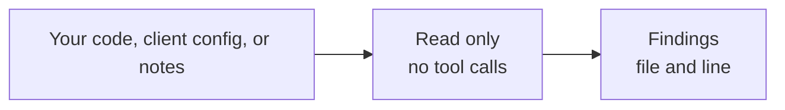

The counts in this page come from the allowed list in this tree: **149 entries** (139 tools, 6 prompts, 4 resources). `tools/list` registers resident surfaces only (`registered_count`: safe 18, scan 22, active-lab 23, full 23). Catalog-only tools are found with `tool_search` and run through `detect_run` / `recon_run` / `exploit_run`, or unlocked with `tool_enable`. Pinned SKILL.md packs are metadata only: `skill_catalog` / `skill_read` scan a local checkout and never clone or execute third-party scripts. `autort capabilities profiles` is the live count after a later change.

## Contents

- [Three ways in](#three-ways-in)
- [Start](#start)
- [Four permission levels](#four-permission-levels)
- [The card the model reads](#the-card-the-model-reads)
- [What the server does at startup](#what-the-server-does-at-startup)
- [How a project check works](#how-a-project-check-works)
- [When a result counts](#when-a-result-counts)
- [The install and the git tree](#the-install-and-the-git-tree)
- [Commands](#commands)
- [GitHub Action](#github-action)
- [Container and client](#container-and-client)
- [Names in the code](#names-in-the-code)
- [License](#license)

## Three ways in

Same program, three doors. All three ask the same allowed list before they run a tool.

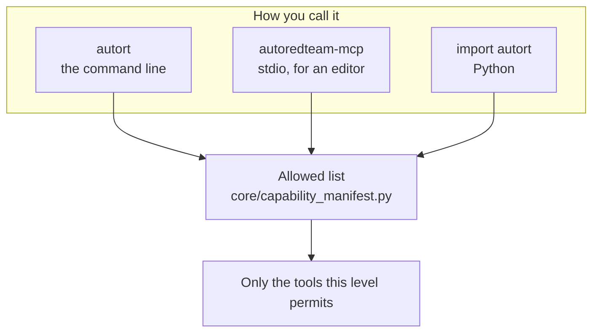

| Door | Command | What a first run should be |
|---|---|---|
| Command line | `autort` or `python -m cli.main` | Read your own handlers |
| Editor server | `autoredteam-mcp --stdio` | Start at `safe` |
| Python | `from autort import Scanner` | Search local CVE notes, or export findings you already have |

`Scanner` and `Reporter` load immediately. `Exploiter`, `AutoPentest`, and `RedTeam` load the first time you ask for them. Importing `Scanner` does not load those three.

A script that imports `core` directly does not pass this check. The check is the three doors above. It is also separate from the API key, from "did a person approve this", and from any container.

## Start

From a checkout, `typer` is enough for the read-only commands.

```bash
pip install typer
python -m cli.main ai-surface scan --path handlers --format sarif -o surface.sarif
python -m cli.main ai-surface scan-mcp-config --path .mcp.json
python -m cli.main capabilities manifest --profile safe
```

On your path:

```bash
pip install autoredteam-orchestrator
pipx install autoredteam-orchestrator
uvx --from autoredteam-orchestrator autort --help
```

Or from git, when the package index is behind the branch you want:

```bash
pip install "git+https://github.com/Coff0xc/AutoRedTeam-Orchestrator.git"
git clone https://github.com/Coff0xc/AutoRedTeam-Orchestrator.git
cd AutoRedTeam-Orchestrator
pip install -r requirements.txt
python -m cli.main --help
```

Python 3.10 or newer. Version `3.1.0` lives only in `_version.py`. The two commands are `autort` and `autoredteam-mcp`.

Any subcommand, including `--help`, prints the legal notice on stderr. `--help` does not ask the allowed list.

## Four permission levels

The level is an argument, or the environment variable `AUTORT_CAPABILITY_PROFILE`, or `safe` when you set neither. `active_lab` and `active-lab` are the same name. Anything else is an error.

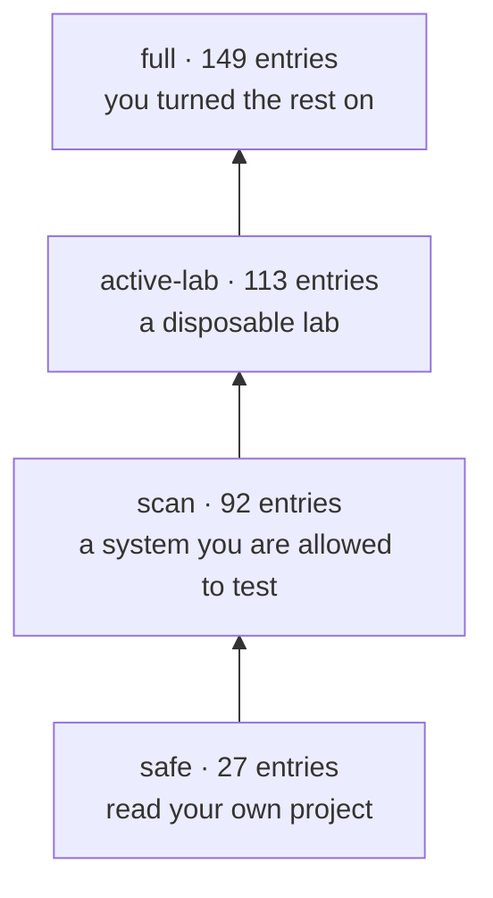

The numbers are totals, including the levels below. New catalog entries at each step: 27, then 65, then 21, then 36. `tools/list` stays small: 18 / 22 / 23 / 23 resident surfaces. Factory detectors, recon modules, exploit modes, and the rest of the catalog stay searchable.

| Level | Use it for | What it adds |
|---|---|---|
| `safe` | Your own checkout, on your own machine | The reader, local CVE search, exporting findings |
| `scan` | A target the owner allowed | Recon and detection. They ship in the install, and they stay behind this level |
| `active-lab` | A machine you can throw away | Lab-only tools. They ask for a separate approval in the record |
| `full` | The same kind of lab, with the rest switched on | The experimental engines that are still in git |

A second switch is the API key. `AUTOREDTEAM_AUTH_MODE` defaults to `strict`, and protected tools then need `AUTOREDTEAM_API_KEY` (`MCP_API_KEY` is the other accepted name). `permissive` logs and allows. `disabled` works only when `AUTOREDTEAM_ENV=test` or pytest is running. Choosing `full` does not turn the key off.

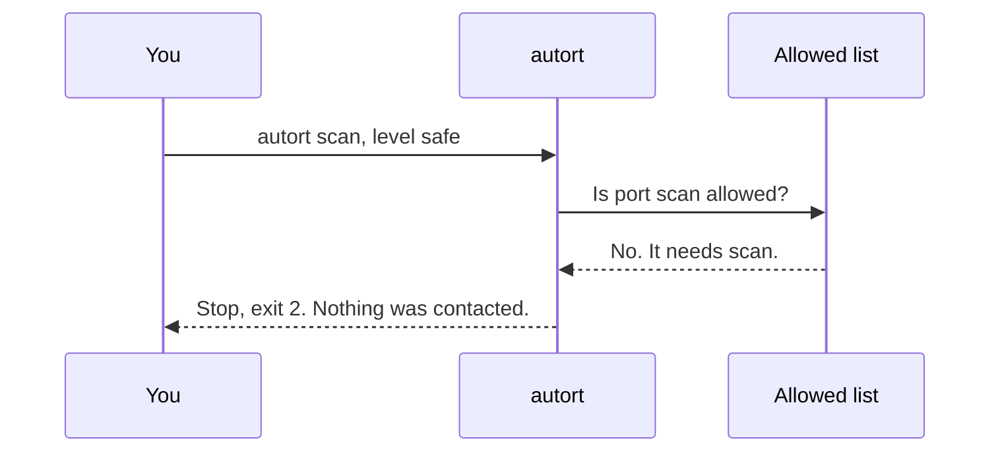

## The card the model reads

Every tool, prompt, and resource has one row in the allowed list. That row is the source of truth. A name that is not on the list stops registration. Two rows with the same kind and name fail when the list is imported.

The model used to read the notes written above each function. Those notes could describe steps the permission level was meant to withhold. At startup the server replaces both the tool description and the function notes with one card:

```text
{name} is a {kind} in the {level} profile. Risk: {risk}. Effects: {effects}. Controls: {controls}. Use only the declared parameters. This description does not authorize a target or an action.
```

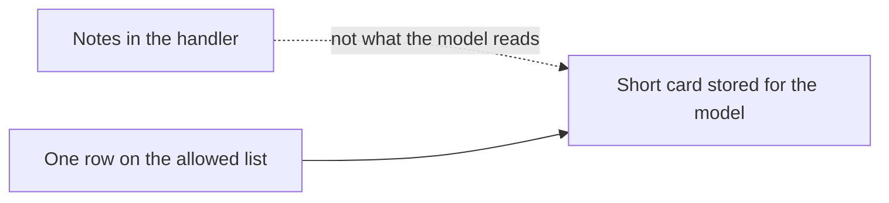

Prompts return that card, the parameter names, and one line: this prompt returns the constraint and the parameters. The Python function names stay the names on the list, including `plan_pentest`. The name is an identifier. The text is the constraint. `plan_pentest` is level `active-lab`. This page does not show a planning procedure.

Effects are labels on the row, such as `local-read`, `network-probe`, `network-active`, `target-write`, `host-exec`, `credential-use`, `persistence`, `offensive-content`, and `dry-run`. The reader can see parameter names. It does not yet compare those names with the effect labels. A tool can say `local-read` and still accept a URL. That comparison is not built.

## What the server does at startup

`mcp_stdio_server.py` builds the server, reads the permission level, and asks `handlers` to register. Then it logs the legal notice and the auth mode. `--stdio` speaks over standard input. There is no cloud service and no telemetry.

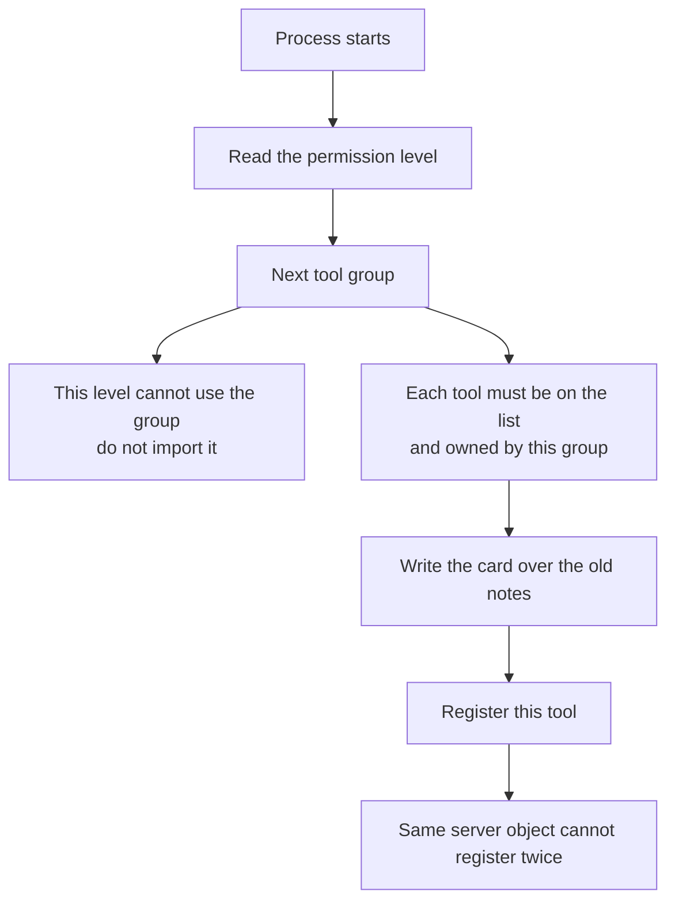

`import handlers` does not load all 22 groups. A group is imported the first time something asks for its register function. Under `safe`, groups that have nothing at that level stay unloaded. That is separate from what the install package leaves out.

A tool pasted into the wrong file fails. The row names the group that owns it. One file may contain a `safe` tool and a `full` tool. The `full` function stays an ordinary function and is not registered.

If one group cannot import, the server logs it and continues with the others. A missing optional library should not blank the reader. A tool missing from the allowed list is different: registration stops. The server should not start half-described.

The order of the 22 groups is fixed so the startup log stays stable, and so each tool is registered by the group the list names. A later group does not need an earlier group to have finished.

## How a project check works

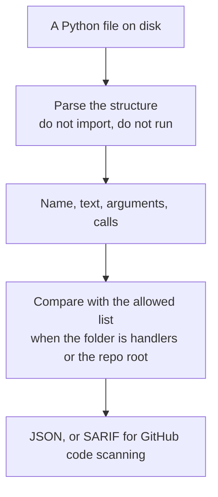

Importing a handler would register tools and could pull in engines. The check has to be able to read a checkout that still contains those engines without starting them.

It understands three ways a tool can appear in source:

| What you wrote | Why the reader looks for it |
|---|---|
| `@tool`, `@prompt`, or `@resource` on a function | The usual style in this repository |
| `Tool(name=...)` | The lower-level MCP type, used where there is no decorator |
| `DetectorConfig(name=...)` | Detector tools are built from a config. There is no function body to walk |

Names are often not written as quotes. `Tool(name=self.name)` is common. The reader remembers simple string assignments in the file, first assignment wins, and follows a name or an attribute back to that string. A name built only at runtime stays invisible. The comparison step then reports which allowed tools the reader never saw.

Risk words are matched on word boundaries. `scan` matches `port_scan`. It does not match `scanner` or `epoch`. The text that is searched is the function name, the full decorator description, the first line of the notes, and the names the function calls. The line stored in the finding is shorter: the first line of the decorator description, or the first line of the notes.

Calls to the permission helpers themselves are ignored. A tool should not look dangerous only because it called the check.

An older shortcut is separate from that word matcher. If the only risky word is `poc`, and the tool name contains the letters `list`, `search`, `stats`, `status`, or `query`, the rating is lowered. `poc_listener` contains `list`, so it is lowered. `tests/fixtures/ai_surface/labels.json` locks that result. Changing the shortcut changes the default handlers scan. It is a measured change, not a cleanup.

A scan of this repository's `handlers/` folder is expected to have **zero issues**. New issues there are a regression in the handlers or in the rules.

### Client config and instruction files

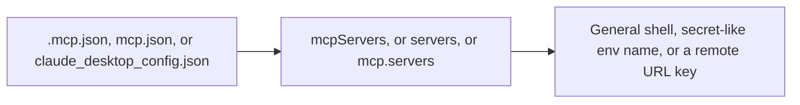

The reader never connects, never sends `initialize`, and never calls `tools/list`.

| What it sees | Why it cares |
|---|---|
| Command is `powershell`, `pwsh`, `cmd`, `bash`, `sh`, `python`, or `node` | A general interpreter can run whatever follows. High. |
| An environment **name** matches `key`, `token`, `secret`, or `password` as a word | It sees names, not secret values. `monkey` is not a key. `api_key` is. Moderate. |
| The object has `url`, `serverUrl`, or `baseUrl` | A remote address is a different trust boundary from stdio. The finding records the key and the line. It does not copy the URL. Moderate. |

Instruction files are markdown, text, YAML, JSON, and TOML. Lockfiles are skipped by name. In a directory, a file over 1 MB is skipped and named in the warnings. A file you named yourself is not size-capped.

`--auth-mode lenient` drops missing-auth issues only. It does not change the rest of the parse.

### Two scans, side by side

`autort ai-surface diff` compares a saved JSON scan with a fresh read of the handlers. It is a command, not a tool the model can call.

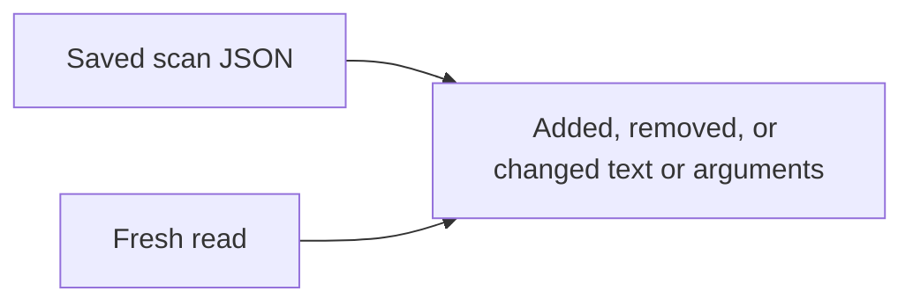

Unchanged tools are left out. Parameter order alone is not a change. Each reported row is at least moderate. A saved file with no findings list warns you, then treats every current tool as added.

## When a result counts

Detectors do not share one result type. Several of them set `verified=True` after a single echo or a syntax check. Treating that flag as proof made the check a test of whether a field was filled in.

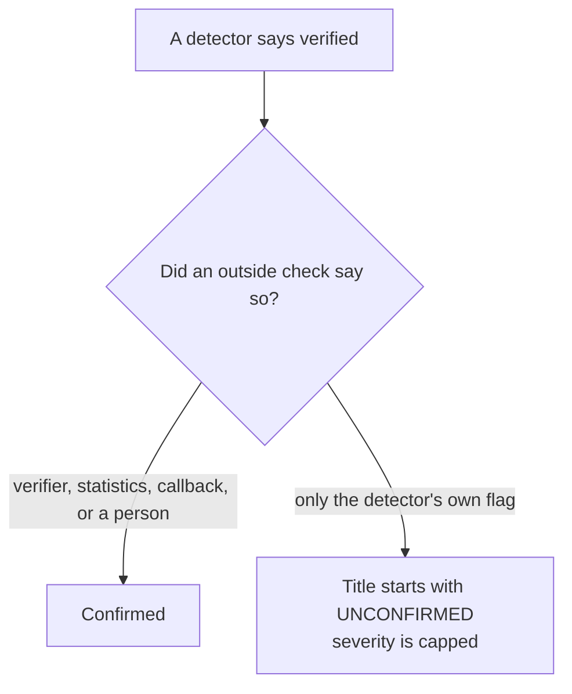

The outside sources are `vuln_verifier`, `statistical_verifier`, `oob_callback`, and `manual_review`. The evidence code does not import the verifier package. Verifiers pull heavier libraries, and a report still has to accept a plain dict. The caller's dict is copied. The check returns the copy.

Confidence from a number: `0.7` and above is high, `0.4` and above is medium, below that is low.

## The install and the git tree

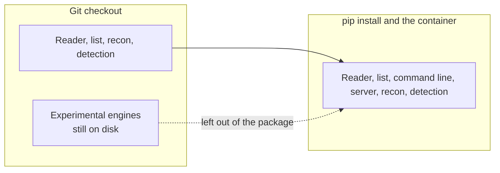

Left out of the package: command-and-control, moving between machines, staying on a machine, post-access work, raising privilege, taking data out, hiding, credentials, Active Directory, and exploit code. They remain in git so an explicit `full` checkout can still import them. Deleting them would break that checkout. A second repository would split the allowed list from the code it describes.

The CI build job installs the package into a clean virtual environment. Those ten packages are not importable there. The `safe` list still prints. A scan of the installed `handlers` folder still reports zero issues. Importing `Scanner` still does not load the three lazy engines. Tests that run inside the checkout do not prove this. Those tests can still import the engines from the working tree. Package the wheel with `pyproject-build`. A leftover setuptools `build/` directory hides `python -m build`.

A published install can still serve the `safe` reader when a handler fails to import a missing engine. That failure is logged. The other groups still register.

Repo scanners that read the git tree still see the experimental code. The package, the container, and the `safe` import rule do not change that.

There is no switch that picks nmap or another outside binary at scan time. Recon and detection call the Python engines in this tree. Outside-tool rows still exist on the allowed list for the levels that name them. The default scan does not shell out to them.

Detector thresholds stay where they are. There is no public accuracy test to tune them against.

## Commands

Installed, the command is `autort`. From a checkout it is `python -m cli.main`.

### Safe

These do not contact a target. CVE search reads the local notes.

| Command | You get | Example |
|---|---|---|
| `ai-surface scan` | An inventory of the handlers | `autort ai-surface scan --path handlers --format sarif -o surface.sarif` |
| `ai-surface scan-mcp-config` | A read of a client config | `autort ai-surface scan-mcp-config --path .mcp.json` |
| `ai-surface scan-skills` | Markers in instruction files | `autort ai-surface scan-skills --path ./skills` |
| `ai-surface diff` | What changed since a saved scan | `autort ai-surface diff --baseline surface.json --path handlers` |
| `capabilities profiles` | The four levels and their counts | `autort capabilities profiles` |
| `capabilities manifest` | One level, as data | `autort capabilities manifest --profile safe` |
| `tools lint` | A contract check of the same parse | `autort tools lint --path handlers` |
| `cve-search` | Local CVE search | `autort cve-search "Log4j" --severity critical --has-poc -n 20` |
| `skills catalog` | Pinned SKILL.md packs (URL, sha, license) | `autort skills catalog` |
| `skills read` | Scan a local checkout, then print SKILL.md if it is not critical | `autort skills read --path ./skills/recon` |
| `version` | The version string | `autort version` |

`autort tools` is the lint group. A function of the same name still exists and is limited to the `scan` level, but the group occupies the command, so that function is not what `autort tools` runs.

| Group | Commands | What it is |
|---|---|---|
| `ai-surface` | `scan`, `scan-mcp-config`, `scan-skills`, `diff` | The reader |
| `capabilities` | `matrix`, `readiness`, `manifest`, `profiles` | The allowed list |
| `tools` | `lint` | Contract check |
| `skills` | `catalog`, `read` | Pinned SKILL.md packs. Read-only |
| `code-agent` | `expand` | Who calls whom, from the source |
| `runtime-api` | `serve` | A local read-only view of a saved run |
| `sandbox` | `docker-smoke` | A local Docker smoke test, network off |
| `ai-redteam` | `run`, `catalog`, `convert`, `eval-run` | A written scenario. Dry-run unless you go further |

### Higher levels

`safe` refuses these. The examples assume a local target you are allowed to test.

| Command | Level | Example |
|---|---|---|
| `scan` | `scan` | `autort scan http://127.0.0.1:8000 --full` |
| `detect` | `scan` | `autort detect http://127.0.0.1:8000 -c sqli,xss,ssrf --format sarif` |
| `nuclei` | `scan` | `autort nuclei http://127.0.0.1:8000 -t cve,rce -s high,critical` |
| `report` | `scan` | `autort report <session-id> -f html` |
| `exploit` | `active-lab` | `autort exploit http://127.0.0.1:8000 --cve CVE-2021-44228` |
| `pentest` | `full` | `autort pentest http://127.0.0.1:8000 --phases recon,vuln_scan` |

`exploit` with neither `--cve` nor `--auto` exits 1 before the permission check.

### Python

Calls are async. Most return a dict. A failure carries an `"error"` string. If the level is too low, the call stops before the engine is imported.

```python
from autort import Exploiter, Reporter
from autort import __version__  # "3.1.0"

exploiter = Exploiter("http://127.0.0.1:8000")
cves = await exploiter.cve_search("Apache Log4j", severity="critical", has_poc=True)

reporter = Reporter("session_id_here")
findings = await reporter.export_findings(format="json")
```

`Scanner` needs `scan`. Set `AUTORT_CAPABILITY_PROFILE=scan` before `full_recon()`, `port_scan()`, `detect_vulns()`, `fingerprint()`, `waf_detect()`, `subdomain_enum()`, `passive_recon()`, or `nuclei_scan()`.

`Reporter.generate()` also needs `scan`. `Exploiter.cve_exploit()`, `auto_exploit()`, and `exploit()` need `active-lab` or above. `AutoPentest.run()` and `resume()` need `full`. `AutoPentest.status(session_id)` stays on `safe`. This page does not show `RedTeam` calls. Those methods are `full`.

## GitHub Action

The example sets `mode` on purpose. Current `main` defaults the Action to `self-audit`. The `v3.1` tag still defaults to `target-scan`, and that mode requires a `target`. The tag was not moved when the default changed.

```yaml
- uses: Coff0xc/AutoRedTeam-Orchestrator@v3.1
  with:
    mode: self-audit
    path: '.'
    severity-threshold: high
```

The full workflow is [`.github/workflows/self-audit.example.yml`](.github/workflows/self-audit.example.yml). Output defaults to SARIF and is uploaded for code scanning. `self-audit` runs `python -m cli.main ai-surface scan`.

`mode: target-scan` remains for an authorized URL. It runs detection, and it needs `target`.

## Container and client

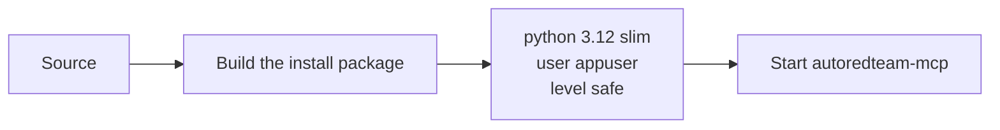

The image does not install nmap. The same experimental trees are dropped, plus payload and wordlist material. The health check imports the server module. The image description is the package sentence: "Local MCP/AI attack-surface audit and evidence gate for authorized testing."

The server speaks stdio.

```bash
autoredteam-mcp --stdio
python -m mcp_stdio_server --stdio
```

```json
{
  "mcpServers": {
    "autoredteam": {
      "command": "autoredteam-mcp",
      "args": ["--stdio"],
      "env": {
        "AUTORT_CAPABILITY_PROFILE": "safe",
        "AUTOREDTEAM_AUTH_MODE": "strict",
        "AUTOREDTEAM_API_KEY": "replace-with-a-real-key"
      }
    }
  }
}
```

Leave the level unset and the server stays on `safe`. This JSON is a valid input to the config reader. The command name `autoredteam-mcp` is not a general interpreter, so that part is quiet. The environment name `AUTOREDTEAM_API_KEY` contains `key`, so the reader reports it. Point the command at a wrapper, and use a name that does not look like a secret, when you want a clean config result.

## Names in the code

The pictures above are the design. This section is the index: file names, counts, and the rules a change has to keep.

<details>
<summary>Allowed list, registration, and the 22 groups</summary>

The row type is `Capability` in `core/capability_manifest.py`. The index key is `(kind, name)`.

| Field | Plain meaning |
|---|---|
| `kind` | `tool`, `prompt`, or `resource` |
| `name` | Public name. Decorator `name=`, or the function name |
| `handler` | Which group owns it. The wrong file is refused |
| `minimum_profile` | Lowest level that may register or call it |
| `risk` | `low`, `moderate`, `high`, `critical`. A label, not a measurement |
| `maturity` | `preview`, `beta`, `experimental`, `restricted-experimental`, `internal`. A label. It does not change registration |
| `auth_required` / `approval_required` | Whether the card mentions a key and a separate approval |
| `executor` | `in-process` (86), `isolated-required` (57), or `external-process` (6) |
| `effects` | Labels joined into the card. Empty renders as `none` |
| `locator` | Resource URI, for a resource |

Current risk mix: moderate 61, critical 47, high 19, low 22. Current maturity mix: restricted-experimental 47, preview 45, beta 40, experimental 11, internal 6.

`require_surface` raises `ProfileDenied` when the level is too low. The command line turns that into exit 2. SDK methods call it before they import the engine, and before the broad `except Exception` that turns an engine failure into `{"success": False, "error": ...}`. A refused level is its own failure.

`handler_enabled` is true when that group owns at least one row allowed at this level. `register_all_handlers` runs once per server object, stored as `_autort_capability_profile`.

| Order | Module | Group key | Rows |
|---:|---|---|---:|
| 1 | `recon_handlers` | `recon` | 10 |
| 2 | `detector_factory` | `detector` | 29 |
| 3 | `evidence_handlers` | `evidence` | 1 |
| 4 | `cve_handlers` | `cve` | 8 |
| 5 | `api_security_handlers` | `api_security` | 7 |
| 6 | `cloud_security_handlers` | `cloud_security` | 3 |
| 7 | `supply_chain_handlers` | `supply_chain` | 3 |
| 8 | `redteam_handlers` | `redteam` | 14 |
| 9 | `orchestration_handlers` | `orchestration` | 12 |
| 10 | `lateral_handlers` | `lateral` | 9 |
| 11 | `persistence_handlers` | `persistence` | 3 |
| 12 | `ad_handlers` | `ad` | 3 |
| 13 | `session_handlers` | `session` | 4 |
| 14 | `report_handlers` | `report` | 2 |
| 15 | `ai_handlers` | `ai` | 13 |
| 16 | `misc_handlers` | `misc` | 5 |
| 17 | `external_tools_handlers` | `external_tools` | 8 |
| 18 | `parallel_handlers` | `parallel` | 1 |
| 19 | `knowledge_handlers` | `knowledge` | 3 |
| 20 | `mcts_handlers` | `mcts` | 1 |
| 21 | `prompt_handlers` | `prompts` | 6 |
| 22 | `resource_handlers` | `resources` | 4 |

The comment at the top of `handlers/__init__.py` matches this table. Registration refuses a name the list does not have.

`ImportError`, `AttributeError`, and `TypeError` from one group are logged and the loop continues. `CapabilityManifestError` is re-raised. MCP 2.3 stores the description argument and returns it from `list_*`. Tests check that every listed description equals the card, for all four levels.

</details>

<details>
<summary>Reader rules, issues, and the comparison with the list</summary>

`scan_handler_surface` walks Python files and uses `ast`. A syntax error, an unreadable file, or a bad encoding becomes a warning. Findings sort by risk, then path, then line.

Skipped directories: `.git`, `.hg`, `.svn`, `.venv`, `venv`, `node_modules`, `__pycache__`, `.mypy_cache`, `.pytest_cache`, `.tox`, `build`, `dist`, `wordlists`, and symlinks. Tests are skipped unless you ask: `tests/`, `test_*.py`, `*_test.py`, and `conftest.py`.

Issues a `@tool` function can get:

| Issue | When |
|---|---|
| `high_risk_tool_without_dangerous_auth` | High or above, and the auth decorator is below dangerous |
| `critical_tool_without_critical_auth` | Critical, and the auth decorator is not critical |
| `target_input_without_handler_validator` | A target-shaped argument has no `validate_inputs` decorator |
| `payload_generation_without_auth_gate` | The text matched `payload` and there is no auth decorator |

Prompts and resources skip that list. Their permission lives on the row.

SARIF rule ids are grouped by class, not one rule per tool: `mcp_tool.auth-critical`, `mcp_tool.auth-missing`, `mcp_tool.target-input`, `mcp_tool.factory`, `mcp_tool.lowlevel`, `mcp_prompt`, `mcp_resource`, `mcp_config`, `skill_instruction`, `surface_inventory_diff`.

The comparison (`reconcile_capability_manifest`) joins on `(kind, name)` when you scan the repo root or a directory named `handlers`.

| Bucket | Meaning |
|---|---|
| `statically_observed` | A finding matches a row, and it is not a detector config |
| `factory_accounted` | The match came from `DetectorConfig` |
| `invisible` | A row had no finding. Reason: `factory-generated`, `prompt`, `resource`, or `unseen` |
| `unlisted` | A finding name is not on the list. Registration would reject it |

JSON stores this at `summary.static_coverage`. SARIF stores it at `runs[].properties.static_coverage`.

Diff issues are `surface_added`, `surface_removed`, `surface_description_changed`, and `surface_parameters_changed`. The join key is `(kind or "tool", tool_name)`. A description change quotes the first 200 characters of the saved text. Rule id is `surface_inventory_diff`.

`core/tooling/contract.py` is `autort tools lint`. It reuses the parse and adds duplicate names, missing annotations, a missing `Args:` section, and whether a high-risk tool looks able to return evidence.

</details>

<details>
<summary>Session, config, recon, and the phase machine</summary>

A target string becomes a `Target` with `value`, `type` (`url`, `ip`, `domain`, `cidr`, `host_port`), `status`, `scheme`, `host`, `port`, and `path`. There is no `url` attribute. Callers build a URL from those parts. Session storage is where a later command resumes.

Config priority is `AUTORT_` environment variables, then YAML, then field defaults. `AUTORT_CONFIG` points at a file. Otherwise the loader looks for `config/config.yaml`, `config/config.yml`, `config.yaml`, and `config.yml`. Missing PyYAML keeps the defaults.

`export_findings` is `safe`. `generate_report` is `scan`. JSON and SARIF are the beta export path. HTML is still hardening. SARIF levels: critical and high are `error`, medium is `warning`, low and info are `note`.

`StandardReconEngine` is the `--full` scan. The order is init, DNS, ports, fingerprint, technology, WAF, subdomains, directories, sensitive-file notes, then a summary. The pieces are pure Python. `core/engine_router.py` was removed. Nothing called it.

`DetectorFactory` is the registry. Detectors subclass `BaseDetector` and implement `detect`. Groups on disk are `access`, `auth`, `file`, `injection`, `misc`, and `request`. A detector that marks itself verified still has to pass the outside-check rule before a report treats the finding as confirmed.

CVE search on `safe` reads `core/cve`. Sync and PoC execution are higher levels. `cve_auto_exploit` is `active-lab`.

`AutoPentestOrchestrator` walks recon, vuln scan, PoC execution, exploit, privilege escalation, lateral movement, exfiltrate, then report. `resume(session_id)` rebuilds it from the last checkpoint. The runtime fields on its config are notes the pipeline reads. They do not create a container.

| Call | Row on the list | Level |
|---|---|---|
| `scan` without `--full` | `port_scan` | `scan` |
| `scan --full` | `full_recon` | `scan` |
| `detect` | `vuln_scan` | `scan` |
| `nuclei` | `nuclei_scan` | `scan` |
| `report` | `generate_report` | `scan` |
| `cve-search` | `cve_search` | `safe` |
| `exploit --cve` | `cve_auto_exploit` | `active-lab` |
| `exploit --auto` | `exploit_orchestrate` | `active-lab` |
| `Exploiter.exploit()` | `exploit_vulnerability` | `active-lab` |
| `pentest` | `auto_pentest` | `full` |
| `pentest --resume` | `pentest_resume` | `full` |
| `AutoPentest.status` | `session_status` | `safe` |

Package exclude globs:

```text
core.c2*  core.lateral*  core.persistence*  core.post_exploit*
core.privilege_escalation*  core.exfiltration*  core.evasion*
core.credential*  core.ad*  core.exploit*
```

`_version` and `mcp_stdio_server` are listed as root modules. They are not packages, and `packages.find` would miss them. The console script would then fail on import.

Coverage in CI measures this same install. The ten engine globs are omitted from both the run and the report, and the workflow fails under 50%. Omitting them only while collecting is not enough: a report will still show files already stored in a `.coverage` file. The floor is "the published install stays measured." It is not a claim that the detectors are fully covered.

`core/agent_runtime` is the state of a planned run: tasks, actions, a trace, and an approval marker. `enforce_sandbox_policy` returns a decision. `execute_action_in_docker_sandbox` stays a decision unless the caller passes `allow_execute=True`. `autort sandbox docker-smoke` runs a local container with the network off. A missing Docker daemon is a skip.

`autort runtime-api serve` reads `/api/runs` on the host and port you pass. The usual local pair is `127.0.0.1` and `8765`. It does not call tools.

`AIRedTeamRunner` plans from a written scenario. Active mode raises `PermissionError` unless the caller passed `allow_active=True`. `core/code_agent` maps Python calls with `ast` and does not run the program.

The knowledge graph (`kg_store`, `kg_query`, `kg_attack_paths`) and `plan_attack_path` are `full`, high risk, maturity `experimental`. They are catalog entries. This repository does not treat them as measured planning results.

</details>

<details>
<summary>What this tree leaves undone</summary>

The reader does not open an MCP session. A live `initialize` / `tools/list` client would see the tools the server registered, which the allowed list already names, and it would have to start the server. The static comparison is the check CI can run on a checkout.

There is no proxy in front of other MCP servers.

Detector algorithms, speed, and thresholds stay where they are until an authorized benchmark exists.

The older `poc` plus `list` shortcut stays while `labels.json` pins it.

Tag `v3.1` stays where it is. Callers who want the `self-audit` default set `mode`, or they track `main`.

Effect labels are not yet checked against parameter names.

</details>

## License

MIT. See [`LICENSE`](LICENSE).

Use it for authorized testing, internal review, education, and local labs. Get permission from the owner of any target. Unauthorized scanning, exploitation, persistence, exfiltration, or evasion is out of scope for this project.
